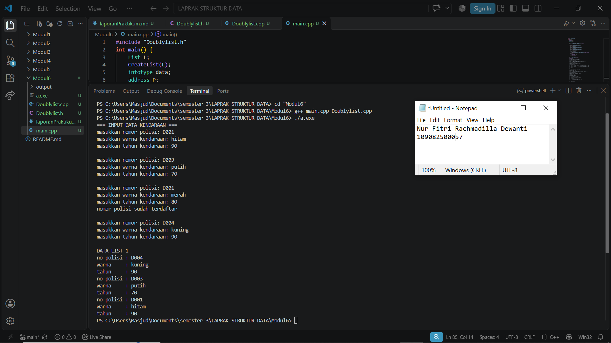
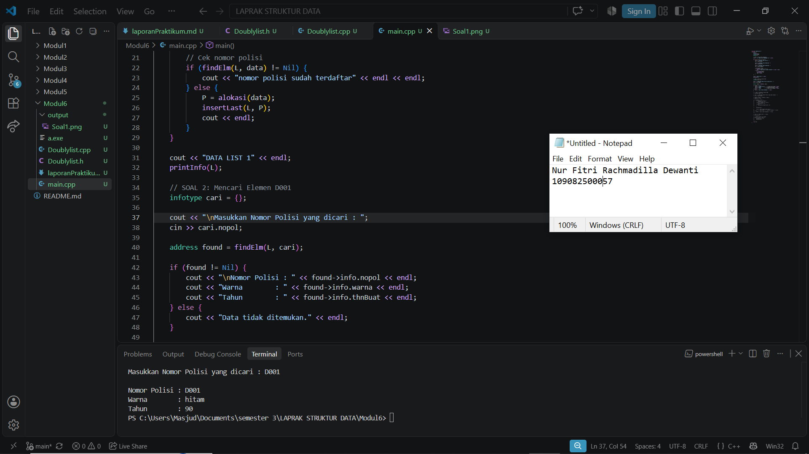
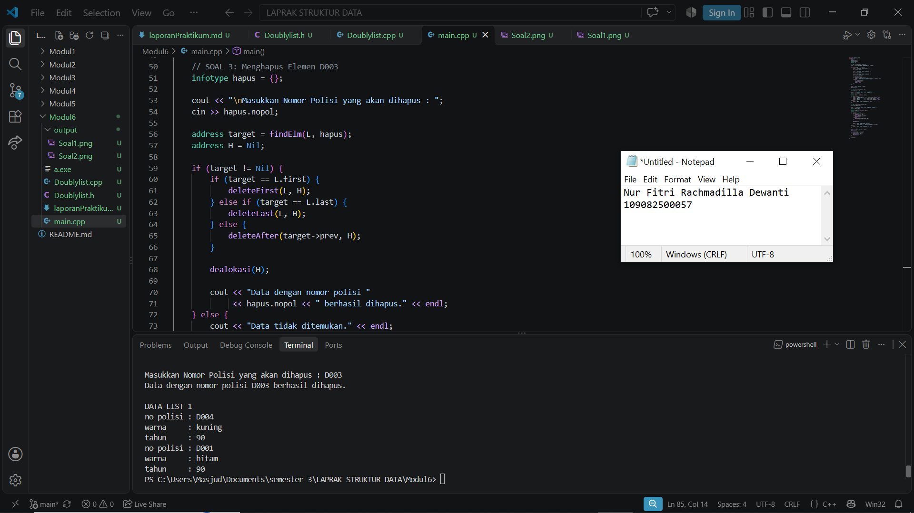

# <h1 align="center">Laporan Praktikum Modul 6 - DOUBLY LINKED LIST (BAGIAN PERTAMA)</h1>

<p align="center">Nur Fitri Rachmadilla Dewanti - 109082500057</p>

## Dasar Teori

Modul 6 membahas tentang Doubly Linked List (Bagian Pertama). Materi ini membahas struktur linked list yang setiap elemennya memiliki dua pointer, yaitu untuk menunjuk elemen sebelumnya dan elemen sesudahnya.


### A. SDoubly Linked List<br/>

Doubly Linked List adalah linked list yang setiap elemennya memiliki dua pointer, yaitu next dan prev.

#### 1. First dan Last
First adalah pointer yang menunjuk elemen pertama, sedangkan Last menunjuk elemen terakhir dalam list.

#### 2. Next dan Prev
Next digunakan untuk menunjuk elemen berikutnya, sedangkan Prev digunakan untuk menunjuk elemen sebelumnya.


### B. Operasi pada Doubly Linked List<br/>

Operasi untuk menambahkan dan menghapus elemen dalam list.

#### 1. Insert
Digunakan untuk menambahkan elemen. Operasinya terdiri dari insertFirst, insertLast, insertAfter, dan insertBefore.

#### 2. Delete
Digunakan untuk menghapus elemen. Operasinya terdiri dari deleteFirst, deleteLast, deleteAfter, dan deleteBefore.

#### 3. Searching, Update, dan View
Digunakan untuk mencari, mengubah, dan menampilkan data. Prosesnya hampir sama seperti pada Singly Linked List, tetapi Doubly Linked List dapat diakses dari arah depan maupun belakang.


### C. Penerapan dalam C++<br/>

Program Doubly Linked List dibagi menjadi tiga file, yaitu:

#### 1. File Header (.h)
Berisi deklarasi struktur data dan fungsi yang digunakan.

#### 2. File Implementasi (.cpp)
Berisi kode fungsi dan prosedur untuk mengelola Doubly Linked List.

#### 3. File Program Utama (main.cpp)
Digunakan untuk menjalankan program dan menampilkan hasilnya.


## Guided

### listMakanan.h

```C++ 
#ifndef LISTMAKANAN_H
#define LISTMAKANAN_H
#define Nil NULL

#include <iostream>
using namespace std;

struct makanan
{
    string nama;
    string jenis;
    float harga;
    float rating;
};

typedef makanan dataMakanan;

typedef struct node *address;

struct node
{
    dataMakanan isidata;
    address next;
    address prev;
};

struct linkedlist
{
    address first;
    address last;
};

bool isEmpty(linkedlist List);
void createList(linkedlist &List);
address alokasi(string nama, string jenis, float harga, float rating);
void dealokasi(address &node);

void insertFirst(linkedlist &List, address nodeBaru);
void insertLast(linkedlist &List, address nodeBaru);
void insertAfter(linkedlist &List, address nodeBaru, address Prev);
void insertBefore(linkedlist &List, address nodeBaru, address nodeNext);

void printList(linkedlist List);

void updateFirst(linkedlist List);
void updateLast(linkedlist List);
void updateAfter(linkedlist List, address prev);
void updateBefore(linkedlist List, address nodeNext);

// Searching
void findByName(linkedlist List, string nama);
void findByJenis(linkedlist List, string jenis);
void findByMinRating(linkedlist List, float minRating);

// Delete
void deleteFirst(linkedlist &List);
void deleteLast(linkedlist &List);
void deleteAfter(linkedlist &List, address Prev);
void deleteBefore(linkedlist &List, address nodeNext);

void deleteNode(linkedlist &List, address target);
void deleteByName(linkedlist &List, string nama);

#endif
```

File list.h berisi deklarasi struktur data makanan yang terdiri dari nama, jenis, harga, dan rating. File ini juga berisi deklarasi fungsi untuk menambahkan, mencari, mengubah, menampilkan, dan menghapus data.


### listMakanan.cpp

```C++ 
#include "listMakanan.h"
#include <iostream>
#include <string>
using namespace std;

bool isEmpty(linkedlist List)
{
    if (List.first == Nil)
    {
        return true;
    }
    else
    {
        return false;
    }
}

void createList(linkedlist &List)
{
    List.first = Nil;
    List.last = Nil;
}

// pembuatan node baru dengan menerapkan manajemen memori
address alokasi(string nama, string jenis, float harga, float rating)
{
    address nodeBaru = new node;
    nodeBaru->isidata.nama = nama;
    nodeBaru->isidata.jenis = jenis;
    nodeBaru->isidata.harga = harga;
    nodeBaru->isidata.rating = rating;
    nodeBaru->next = Nil;
    nodeBaru->prev = Nil;
    return nodeBaru;
}

void dealokasi(address &node)
{
    node->next = Nil;
    node->prev = Nil;
    delete node;
}

void insertFirst(linkedlist &List, address nodeBaru)
{
    if (isEmpty(List))
    {
        List.first = List.last = nodeBaru;
    }
    else
    {
        nodeBaru->next = List.first;
        List.first->prev = nodeBaru;
        List.first = nodeBaru;
    }
    cout << "Node " << nodeBaru->isidata.nama << " berhasil ditambahkan sebagai node pertama list" << endl;
}

void insertLast(linkedlist &List, address nodeBaru)
{
    if (isEmpty(List) == true)
    {
        List.first = List.last = nodeBaru;
    }
    else
    {
        nodeBaru->prev = List.last;
        List.last->next = nodeBaru;
        List.last = nodeBaru;
    }
    cout << "Node " << nodeBaru->isidata.nama << " berhasil ditambahkan sebagai node terakhir list" << endl;
}

void insertAfter(linkedlist &List, address nodeBaru, address nodePrev)
{
    if (isEmpty(List) == true)
    {
        List.first = List.last = nodeBaru;
    }
    else
    {
        if (nodePrev != Nil)
        {
            if (nodePrev == List.last)
            {
                insertLast(List, nodeBaru);
            }
            else
            {
                nodeBaru->next = nodePrev->next;
                nodeBaru->prev = nodePrev;
                (nodePrev->next)->prev = nodeBaru;
                nodePrev->next = nodeBaru;
                cout << "Node " << nodeBaru->isidata.nama << " berhasil ditambahkan setelah node " << nodePrev->isidata.nama << endl;
            }
        }
        else
        {
            cout << "node sebelumnya (nodePrev) tidak valid!" << endl;
        }
    }
}

void insertBefore(linkedlist &List, address nodeBaru, address nodeNext)
{
    if (isEmpty(List) == true)
    {
        List.first = List.last = nodeBaru;
    }
    else
    {
        if (nodeNext != Nil)
        {
            if (nodeNext == List.first)
            {
                insertFirst(List, nodeBaru);
            }
            else
            {
                nodeBaru->next = nodeNext;
                nodeBaru->prev = nodeNext->prev;
                (nodeNext->prev)->next = nodeBaru;
                nodeNext->prev = nodeBaru;
                cout << "Node " << nodeBaru->isidata.nama << " berhasil ditambahkan sebelum node " << nodeNext->isidata.nama << endl;
            }
        }
        else
        {
            cout << "node setelahnya (nodeNext) tidak valid!" << endl;
        }
    }
}

void printList(linkedlist List)
{
    if (isEmpty(List) == true)
    {
        cout << "List kosong!" << endl;
    }
    else
    {
        address nodeBantu = List.first;
        while (nodeBantu != Nil)
        {
            cout << "Nama makanan : " << nodeBantu->isidata.nama << endl;
            cout << "Jenis        : " << nodeBantu->isidata.jenis << endl;
            cout << "Harga        : " << nodeBantu->isidata.harga << endl;
            cout << "Rating       : " << nodeBantu->isidata.rating << endl;
            cout << "-------------------------------" << endl;
            nodeBantu = nodeBantu->next;
        }
    }
}

void updateFirst(linkedlist List)
{
    if (isEmpty(List) == true)
    {
        cout << "List kosong!" << endl;
    }
    else
    {
        cout << "Masukkan update data node pertama : " << endl;
        cout << "Nama makanan : ";
        getline(cin, List.first->isidata.nama);
        cout << "Jenis makanan : ";
        getline(cin, List.first->isidata.jenis);
        cout << "Harga : ";
        cin >> List.first->isidata.harga;
        cout << "Rating : ";
        cin >> List.first->isidata.rating;
        cin.ignore(); // menghapus karakter newline (/n) dari input buffer
        cout << "Data Berhasil Diupdate!" << endl;
        cout << endl;
    }
}

void updateLast(linkedlist List)
{
    if (isEmpty(List) == true)
    {
        cout << "List kosong!" << endl;
    }
    else
    {
        cout << "Masukkan update data node terakhir : " << endl;
        cout << "Nama makanan : ";
        getline(cin, List.last->isidata.nama);
        cout << "Jenis makanan : ";
        getline(cin, List.last->isidata.jenis);
        cout << "Harga : ";
        cin >> List.last->isidata.harga;
        cout << "Rating : ";
        cin >> List.last->isidata.rating;
        cin.ignore(); // menghapus karakter newline (/n) dari input buffer
        cout << "Data Berhasil Diupdate!" << endl;
        cout << endl;
    }
}

void updateAfter(linkedlist List, address nodePrev)
{
    if (isEmpty(List) == true)
    {
        cout << "List kosong!" << endl;
    }
    else
    {
        if (nodePrev != Nil && nodePrev->next != Nil)
        {
            address nodeBantu = nodePrev->next;
            cout << "masukkan update data node setelah node " << nodePrev->isidata.nama << " : " << endl;
            cout << "Nama makanan : ";
            getline(cin, nodeBantu->isidata.nama);
            cout << "Jenis makanan : ";
            getline(cin, nodeBantu->isidata.jenis);
            cout << "Harga : ";
            cin >> nodeBantu->isidata.harga;
            cout << "Rating : ";
            cin >> nodeBantu->isidata.rating;
            cin.ignore(); // menghapus karakter newline (/n) dari input buffer
            cout << "Data Berhasil Diupdate!" << endl;
            cout << endl;
        }
        else
        {
            cout << "Node sebelumnya (nodePrev) tidak valid!" << endl;
        }
    }
}

void updateBefore(linkedlist List, address nodeNext)
{
    if (isEmpty(List) == true)
    {
        cout << "List kosong!" << endl;
    }
    else
    {
        if (nodeNext != Nil && nodeNext->prev != Nil)
        {
            address nodeBantu = nodeNext->prev;
            cout << "masukkan update data node sebelum node " << nodeNext->isidata.nama << " : " << endl;
            cout << "Nama makanan : ";
            getline(cin, nodeBantu->isidata.nama);
            cout << "Jenis makanan : ";
            getline(cin, nodeBantu->isidata.jenis);
            cout << "Harga : ";
            cin >> nodeBantu->isidata.harga;
            cout << "Rating : ";
            cin >> nodeBantu->isidata.rating;
            cin.ignore(); // menghapus karakter newline (/n) dari input buffer
            cout << "Data Berhasil Diupdate!" << endl;
            cout << endl;
        }
        else
        {
            cout << "Node sebelumnya (prev) tidak valid!" << endl;
        }
    }
}

// SEARCHING
void findByName(linkedlist List, string nama)
{
    if (isEmpty(List))
    {
        cout << "List kosong!" << endl;
        return;
    }
    address p = List.first;
    while (p != Nil)
    {
        if (p->isidata.nama == nama)
        {
            cout << "Ditemukan (berdasarkan nama):" << endl;
            cout << "Nama makanan : " << p->isidata.nama << endl;
            cout << "Jenis        : " << p->isidata.jenis << endl;
            cout << "Harga        : " << p->isidata.harga << endl;
            cout << "Rating       : " << p->isidata.rating << endl;
            return;
        }
        p = p->next;
    }
    cout << "Data dengan nama \"" << nama << "\" tidak ditemukan." << endl;
}

void findByJenis(linkedlist List, string jenis)
{
    if (isEmpty(List))
    {
        cout << "List kosong!" << endl;
        return;
    }
    address p = List.last;
    while (p != Nil)
    {
        if (p->isidata.jenis == jenis)
        {
            cout << "Ditemukan (berdasarkan jenis):" << endl;
            cout << "Nama makanan : " << p->isidata.nama << endl;
            cout << "Jenis        : " << p->isidata.jenis << endl;
            cout << "Harga        : " << p->isidata.harga << endl;
            cout << "Rating       : " << p->isidata.rating << endl;
            return;
        }
        p = p->prev;
    }
    cout << "Data dengan jenis \"" << jenis << "\" tidak ditemukan." << endl;
}

void findByMinRating(linkedlist List, float minRating)
{
    if (isEmpty(List))
    {
        cout << "List kosong!" << endl;
        return;
    }
    address p = List.last;
    while (p != Nil)
    {
        if (p->isidata.rating >= minRating)
        {
            cout << "Ditemukan (rating >= " << minRating << "):" << endl;
            cout << "Nama makanan : " << p->isidata.nama << endl;
            cout << "Jenis        : " << p->isidata.jenis << endl;
            cout << "Harga        : " << p->isidata.harga << endl;
            cout << "Rating       : " << p->isidata.rating << endl;
            return;
        }
        p = p->prev;
    }
    cout << "Tidak ada data dengan rating >= " << minRating << "." << endl;
}

// DELETE
void deleteFirst(linkedlist &List)
{
    if (isEmpty(List) == true)
    {
        cout << "List kosong! Tidak ada node yang dihapus." << endl;
        return;
    }
    address pDel = List.first;
    if (List.first == List.last)
    {
        List.first = List.last = Nil;
    }
    else
    {
        List.first = pDel->next;
        List.first->prev = Nil;
        pDel->next = Nil;
    }
    pDel->prev = Nil;
    cout << "Node " << pDel->isidata.nama << " berhasil dihapus dari posisi pertama." << endl;
    dealokasi(pDel);
}

void deleteLast(linkedlist &List)
{
    if (isEmpty(List) == true)
    {
        cout << "List kosong! Tidak ada node yang dihapus." << endl;
        return;
    }
    address pDel = List.last;
    if (List.first == List.last)
    {
        List.first = List.last = Nil;
    }
    else
    {
        List.last = pDel->prev;
        List.last->next = Nil;
        pDel->prev = Nil;
    }
    pDel->next = Nil;
    cout << "Node " << pDel->isidata.nama << " berhasil dihapus dari posisi terakhir." << endl;
    dealokasi(pDel);
}

void deleteAfter(linkedlist &List, address Prev)
{
    if (isEmpty(List) == true)
    {
        cout << "List kosong! Tidak ada node yang dihapus." << endl;
        return;
    }
    if (Prev == Nil || Prev->next == Nil)
    {
        cout << "Node sebelumnya (Prev) tidak valid atau tidak ada node setelahnya!" << endl;
        return;
    }
    if (Prev->next == List.last)
    {
        deleteLast(List);
        return;
    }
    address pDel = Prev->next;
    Prev->next = pDel->next;
    pDel->next->prev = Prev;
    pDel->next = Nil;
    pDel->prev = Nil;
    cout << "Node " << pDel->isidata.nama << " berhasil dihapus setelah node " << Prev->isidata.nama << "." << endl;
    dealokasi(pDel);
}

void deleteBefore(linkedlist &List, address nodeNext)
{
    if (isEmpty(List) == true)
    {
        cout << "List kosong! Tidak ada node yang dihapus." << endl;
        return;
    }
    if (nodeNext == Nil || nodeNext->prev == Nil)
    {
        cout << "Node setelahnya (nodeNext) tidak valid atau tidak ada node sebelumnya!" << endl;
        return;
    }
    if (nodeNext->prev == List.first)
    {
        deleteFirst(List);
        return;
    }
    address pDel = nodeNext->prev;
    nodeNext->prev = pDel->prev;
    pDel->prev->next = nodeNext;
    pDel->next = Nil;
    pDel->prev = Nil;
    cout << "Node " << pDel->isidata.nama << " berhasil dihapus sebelum node " << nodeNext->isidata.nama << "." << endl;
    dealokasi(pDel);
}

void deleteNode(linkedlist &List, address target)
{
    if (isEmpty(List) == true || target == Nil)
    {
        cout << "Target tidak valid atau list kosong!" << endl;
        return;
    }
    if (target == List.first)
    {
        deleteFirst(List);
    }
    else if (target == List.last)
    {
        deleteLast(List);
    }
    else
    {
        address L = target->prev;
        address R = target->next;
        L->next = R;
        R->prev = L;
        target->next = Nil;
        target->prev = Nil;
        cout << "Node " << target->isidata.nama << " berhasil dihapus dari tengah list." << endl;
        dealokasi(target);
    }
}

void deleteByName(linkedlist &List, string nama)
{
    if (isEmpty(List))
    {
        cout << "List kosong! Tidak ada node yang dihapus." << endl;
        return;
    }

    address target = List.first;
    while (target != Nil && target->isidata.nama != nama)
    {
        target = target->next;
    }
    if (target == Nil)
    {
        cout << "Node dengan nama \"" << nama << "\" tidak ditemukan." << endl;
        return;
    }

    deleteNode(List, target);
    cout << "Node dengan nama \"" << nama << "\" telah dihapus dan didealokasi." << endl;
}
```

File list.cpp berisi implementasi fungsi-fungsi untuk mengelola Doubly Linked List, seperti membuat list, menambahkan data, mengubah data, mencari makanan, menampilkan list, dan menghapus elemen.


### main.cpp

```C++ 
#include "listMakanan.h"
#include <iostream>

using namespace std;

int main()
{
    linkedlist List;
    address nodeA, nodeB, nodeC, nodeD, nodeE = Nil;
    createList(List);

    dataMakanan dtMakanan;

    nodeA = alokasi("Nasi Rames", "Makanan Berat", 10000, 8.5);
    nodeB = alokasi("Ayam Geprek", "Makanan Berat", 13000, 9.0);
    nodeC = alokasi("Risol Mayo", "Makanan Ringan", 3500, 8.8);
    nodeD = alokasi("Mie Ayam", "Makanan Berat", 15000, 9.9);
    nodeE = alokasi("Donat", "Makanan Ringan", 2000, 7.7);

    insertFirst(List, nodeD);
    insertLast(List, nodeE);
    insertAfter(List, nodeA, nodeD);
    insertBefore(List, nodeC, nodeE);
    insertLast(List, nodeB);
    cout << endl;

    // D - A - C - E - B
    cout << "--- Isi List Setelah Insert ---" << endl;
    printList(List);
    cout << endl;

    updateFirst(List);
    updateLast(List);
    updateBefore(List, nodeC);
    updateAfter(List, nodeA);

    cout << "--- Isi List Setelah Update ---" << endl;
    printList(List);

    cout << endl;

    findByName(List, "Nasgor");
    findByMinRating(List, 9.0);

    deleteByName(List, "Nasgor");
    deleteFirst(List);
    deleteBefore(List, nodeE);

    cout << endl
         << "--- Isi List Setelah Delete ---" << endl;
    printList(List);

    return 0;
}
```

File main.cpp merupakan program utama yang digunakan untuk menjalankan program. Program ini digunakan untuk menjalankan program. Program ini membuat lima data makanan, kemudian melakukan proses insert, update, searching, dan delete. Setelah itu, program menampilkan data makanan setelah perubahan.


## Unguided

### Doublylist.h

```C++
#ifndef DOUBLYLIST_H
#define DOUBLYLIST_H

#include <iostream>
#include <string>
using namespace std;

#define Nil nullptr

struct kendaraan {
    string nopol;
    string warna;
    int thnBuat;
};

typedef kendaraan infotype;
typedef struct elmlist *address;

struct elmlist {
    infotype info;
    address next;
    address prev;
};

struct list {
    address first;
    address last;
};
typedef struct list List;

void CreateList(List &L);
address alokasi(infotype x);
void dealokasi(address &P);
void printInfo(List L);
void insertLast(List &L, address P);

address findElm(List L, infotype x);

void deleteFirst(List &L, address &P);
void deleteLast(List &L, address &P);
void deleteAfter(address Prec, address &P);

#endif
```

### Doublylist.cpp

```C++
#include "Doublylist.h"

// list kosong
void CreateList(List &L) {
    L.first = Nil;
    L.last = Nil;
}

// elemen baru
address alokasi(infotype x) {
    address P = new elmlist;
    P->info = x;
    P->next = Nil;
    P->prev = Nil;
    return P;
}

// hapus elemen dari memori
void dealokasi(address &P) {
    if (P != Nil) {
        delete P;
        P = Nil;
    }
}

// masukkan elemen di akhir list
void insertLast(List &L, address P) {
    if (L.first == Nil) {
        L.first = P;
        L.last = P;
    } else {
        P->prev = L.last;
        L.last->next = P;
        L.last = P;
    }
}

// nampilkan informasi kendaraan
void printInfo(List L) {
    address P = L.last;

    while (P != Nil) {
        cout << "no polisi : " << P->info.nopol << endl;
        cout << "warna     : " << P->info.warna << endl;
        cout << "tahun     : " << P->info.thnBuat << endl;

        P = P->prev;
    }
}

// SOAL 2: Mencari elemen berdasarkan nomor polisi
address findElm(List L, infotype x) {
    address P = L.first;

    while (P != Nil) {
        if (P->info.nopol == x.nopol) {
            return P;
        }

        P = P->next;
    }

    return Nil;
}

// SOAL 3: Menghapus elemen pertama
void deleteFirst(List &L, address &P) {
    if (L.first == Nil) {
        P = Nil;
    } else {
        P = L.first;

        if (L.first == L.last) {
            L.first = Nil;
            L.last = Nil;
        } else {
            L.first = L.first->next;
            L.first->prev = Nil;
        }

        P->next = Nil;
        P->prev = Nil;
    }
}

// SOAL 3: Menghapus elemen terakhir
void deleteLast(List &L, address &P) {
    if (L.last == Nil) {
        P = Nil;
    } else {
        P = L.last;

        if (L.first == L.last) {
            L.first = Nil;
            L.last = Nil;
        } else {
            L.last = L.last->prev;
            L.last->next = Nil;
        }

        P->next = Nil;
        P->prev = Nil;
    }
}

// SOAL 3: Menghapus elemen setelah Prec
void deleteAfter(address Prec, address &P) {
    if (Prec == Nil || Prec->next == Nil) {
        P = Nil;
    } else {
        P = Prec->next;
        Prec->next = P->next;

        if (P->next != Nil) {
            P->next->prev = Prec;
        }

        P->next = Nil;
        P->prev = Nil;
    }
}
```

### main.cpp

```C++
#include "Doublylist.h"
int main() {
    List L;
    CreateList(L);
    infotype data;
    address P;

    // SOAL 1: Input Data Kendaraan 
    cout << "=== INPUT DATA KENDARAAN ===" << endl;

    for (int i = 0; i < 4; i++) {
        cout << "masukkan nomor polisi: ";
        cin >> data.nopol;

        cout << "masukkan warna kendaraan: ";
        cin >> data.warna;

        cout << "masukkan tahun kendaraan: ";
        cin >> data.thnBuat;

        // Cek nomor polisi
        if (findElm(L, data) != Nil) {
            cout << "nomor polisi sudah terdaftar" << endl << endl;
        } else {
            P = alokasi(data);
            insertLast(L, P);
            cout << endl;
        }
    }

    cout << "DATA LIST 1" << endl;
    printInfo(L);

    // SOAL 2: Mencari Elemen D001 
    infotype cari = {};

    cout << "\nMasukkan Nomor Polisi yang dicari : ";
    cin >> cari.nopol;

    address found = findElm(L, cari);

    if (found != Nil) {
        cout << "\nNomor Polisi : " << found->info.nopol << endl;
        cout << "Warna        : " << found->info.warna << endl;
        cout << "Tahun        : " << found->info.thnBuat << endl;
    } else {
        cout << "Data tidak ditemukan." << endl;
    }

    // SOAL 3: Menghapus Elemen D003 
    infotype hapus = {};

    cout << "\nMasukkan Nomor Polisi yang akan dihapus : ";
    cin >> hapus.nopol;

    address target = findElm(L, hapus);
    address H = Nil;

    if (target != Nil) {
        if (target == L.first) {
            deleteFirst(L, H);
        } else if (target == L.last) {
            deleteLast(L, H);
        } else {
            deleteAfter(target->prev, H);
        }

        dealokasi(H);

        cout << "Data dengan nomor polisi "
             << hapus.nopol << " berhasil dihapus." << endl;
    } else {
        cout << "Data tidak ditemukan." << endl;
    }

    cout << "\nDATA LIST 1" << endl;
    printInfo(L);

    // Membersihkan sisa elemen
    while (L.first != Nil) {
        deleteFirst(L, H);
        dealokasi(H);
    }

    return 0;
}
```

### Output Unguided 1 :

##### Output 1






Program ini menggunakan tiga file, yaitu Doublylist.h, Doublylist.cpp, dan main.cpp.
File Doublylist.h berisi deklarasi struktur data kendaraan dan fungsi-fungsi yang digunakan dalam Doubly Linked List.
File Doublylist.cpp berisi implementasi fungsi untuk membuat list, menambah data, menampilkan data, mencari data, dan menghapus elemen.
File main.cpp merupakan program utama. Program digunakan untuk memasukkan data kendaraan, mengecek nomor polisi yang duplikat, mencari kendaraan dengan nomor polisi tertentu, dan menghapus data kendaraan yang dipilih.


## Kesimpulan

Berdasarkan praktikum Modul 6, saya belajar tentang Doubly Linked List dan cara menggunakannya dalam bahasa C++. Saya memahami fungsi pointer first, last, next, dan prev, serta cara menambah, menampilkan, mencari, dan menghapus data kendaraan dalam sebuah list.


## Referensi

[1] Triase. (2020). Diktat Edisi Revisi : STRUKTUR DATA. Medan: UNIVERSTAS ISLAM NEGERI SUMATERA UTARA MEDAN.
<br>[2] Indahyati, Uce., Rahmawati Yunianita. (2020). "BUKU AJAR ALGORITMA DAN PEMROGRAMAN DALAM BAHASA C++". Sidoarjo: Umsida Press. Diakses pada 10 Maret 2024 melalui https://doi.org/10.21070/2020/978-623-6833-67-4.
<br>[3] GeeksforGeeks. (2025). Doubly Linked List Tutorial. Diakses melalui https://www.geeksforgeeks.org/dsa/doubly-linked-list/.
<br>[4] Modul 6: Doubly Linked List (Bagian Pertama). Modul Praktikum Struktur Data, hlm. 51–58.