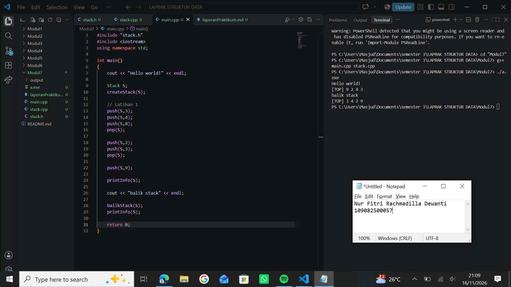
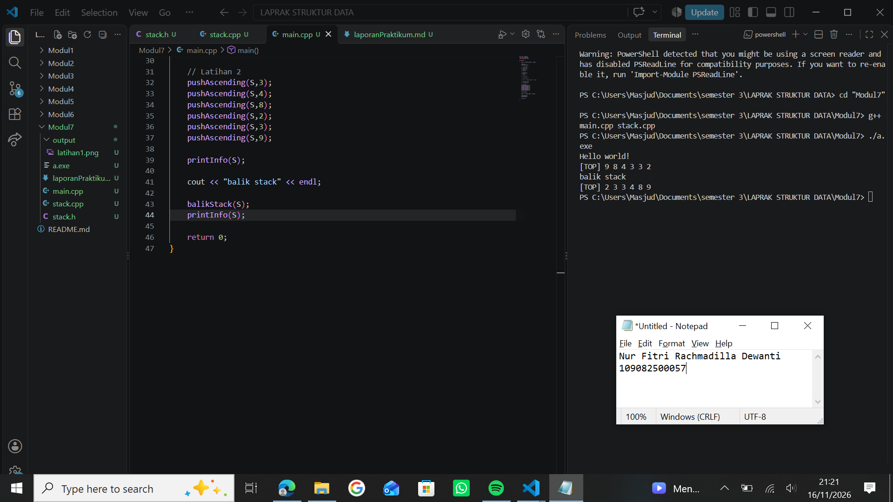
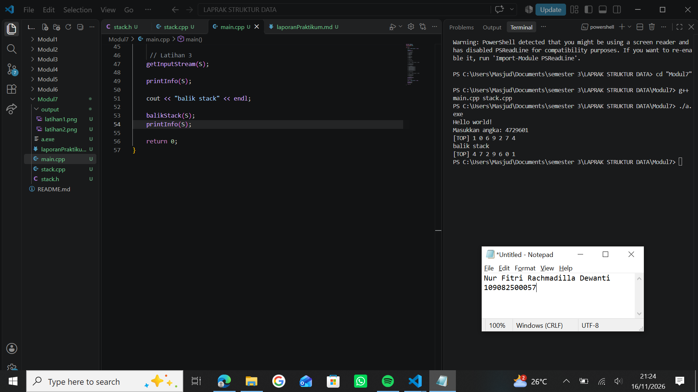

# <h1 align="center">Laporan Praktikum Modul 7 - STACK</h1>

<p align="center">Nur Fitri Rachmadilla Dewanti - 109082500057</p>

## Dasar Teori

Modul 7 membahas tentang Stack. Materi ini membahas struktur data yang menggunakan prinsip tumpukan, yaitu data yang terakhir masuk akan menjadi data pertama yang keluar.


### A. Pengertian Stack<br/>

Stack adalah struktur data yang menggunakan prinsip tumpukan atau LIFO (Last In First Out).

#### 1. LIFO (Last In First Out)
Data yang terakhir dimasukkan akan menjadi data pertama yang diambil atau dikeluarkan.

#### 2. Top
Top adalah bagian paling atas dari stack yang digunakan untuk menunjukkan posisi elemen teratas.


### B. Operasi pada Stack<br/>

Operasi utama pada Stack digunakan untuk menambahkan dan mengambil data.

#### 1. Push
Digunakan untuk menambahkan elemen baru ke dalam stack. Setiap data yang dimasukkan akan menempati posisi paling atas.

#### 2. Pop
Digunakan untuk mengambil atau menghapus elemen paling atas dari stack.


### C. Stack dengan Representasi Array<br/>

Stack dapat dibuat menggunakan array yang memiliki jumlah penyimpanan terbatas.

#### 1. Info
Array yang digunakan untuk menyimpan elemen atau data di dalam stack.

#### 2. Top
Digunakan untuk menunjukkan jumlah elemen atau posisi teratas dalam stack.

#### 3. Push dan Pop
Pada representasi array, Push menambahkan nilai Top, sedangkan Pop mengurangi nilai Top setelah mengambil data paling atas.


### D. Primitif-primitif dalam Stack<br/>

Primitif merupakan fungsi atau prosedur yang digunakan untuk mengelola data dalam stack.

#### 1. CreateStack()
Digunakan untuk membuat stack dalam keadaan kosong.

#### 2. IsEmpty()
Digunakan untuk memeriksa apakah stack kosong.

#### 3. Alokasi dan Dealokasi
Digunakan untuk mengatur penggunaan memori pada stack dengan representasi pointer.

#### 4. Fungsi Pencarian
Digunakan untuk mencari data yang terdapat di dalam stack.


### E. Penerapan dalam C++<br/>

Program Stack menggunakan tiga file, yaitu:

#### 1. stack.h
Berisi deklarasi struktur Stack dan fungsi yang digunakan.

#### 2. stack.cpp
Berisi kode fungsi dan prosedur untuk mengelola Stack.

#### 3. main.cpp
Digunakan untuk menjalankan program dan mencoba fungsi-fungsi Stack.


## Guided

// Stack menggunakan array
### stack.h

```C++ 
#ifndef STACK_TABLE
#define STACK_TABLE
#include <iostream>
using namespace std;
const int MAX = 10;

struct stackTable
{
    int data[MAX];
    int top;
};
bool isEmpty(stackTable s);
bool isFull(stackTable s);
void createStack(stackTable &s);
void push(stackTable &s, int angka);
void pop(stackTable &s);
void update(stackTable &s, int posisi);
void view(stackTable s);
void searchData(stackTable s, int data);
#endif
```

File stack.h untuk membuat struktur Stack menggunakan array dengan kapasitas 10 data dan mendeklarasikan fungsi-fungsi yang digunakan.


### stack.cpp

```C++ 
#include "stack.h"
#include <iostream>
using namespace std;

bool isEmpty(stackTable s)
{
    return s.top == -1;
}
bool isFull(stackTable s)
{
    return s.top == MAX - 1;
}
void createStack(stackTable &s)
{
    s.top = -1;
}
void push(stackTable &s, int angka)
{

    if (isFull(s))
    {
        cout << "Stack penuh!" << endl;
    }
    else
    {
        s.top++;
        s.data[s.top] = angka;
        cout << "Data" << angka << "berhasil ditambahkan kedalam stack !" << endl;
    }
}

void pop(stackTable &s)
{
    if (isEmpty(s))
    {
        cout << "Stack kosong!" << endl;
    }
    else
    {
        int val = s.data[s.top];
        s.top--;
        cout << "Data" << val << " berhasil dihapus dari stack!" << endl;
    }
}

void update(stackTable &s, int posisi)
{
    if (isEmpty(s))
    {
        cout << "Stack kosong!" << endl;
    }
    if (posisi <= 0)
    {
        cout << "Posisi tidak valid!" << endl;
        return;
    }
    // index = top

    int idx = s.top - (posisi - 1);
    if (idx < 0 || idx > s.top)
    {
        cout << "Posisi " << posisi << " tidak valid!" << endl;
        return;
    }

    cout << "Update data posisi ke-" << posisi << endl;
    cout << "Masukkan angka : ";
    cin >> s.data[idx];
    cout << "Data berhasil diupdate!" << endl;
    cout << endl;
}

void view(stackTable s)
{
    if (isEmpty(s))
    {
        cout << "Stack kosong!" << endl;
    }
    else
    {
        for (int i = s.top; i >= 0; --i)
        {
            cout << s.data[i] << " ";
        }
    }
    cout << endl;
}

void searchData(stackTable s, int data)
{
    if (isEmpty(s))
    {
        cout << "Stack kosong!" << endl;
        return;
    }

    cout << "Mencari data " << data << "..." << endl;
    int posisi = 1;
    bool found = false;

    for (int i = s.top; i >= 0; --i)
    {
        if (s.data[i] == data)
        {
            cout << "Data " << data << " ditemukan pada posisi ke-" << posisi << endl;
            cout << endl;
            found = true;
            break;
        }
        posisi++;
    }

    if (!found)
    {
        cout << "Data " << data << " tidak ditemukan didalam stack!" << endl;
        cout << endl;
    }
}
```

File stack.cpp untuk menjalankan fungsi-fungsi Stack, seperti push() untuk menambahkan data, pop() untuk menghapus data, update() untuk mengubah data, view() untuk menampilkan data, dan searchData() untuk mencari data.


### main.cpp

```C++ 
#include "stack.h"
#include <iostream>

using namespace std;

int main()
{
    stackTable s;
    createStack(s);

    push(s, 1);
    push(s, 2);
    push(s, 3);
    push(s, 4);
    push(s, 5);
    cout << endl;

    cout << "--- Stack setelah push ---" << endl;
    view(s);
    cout << endl;

    pop(s);
    pop(s);
    cout << endl;

    cout << "--- Stack setelah pop 2 kali ---" << endl;
    view(s);
    cout << endl;

    update(s, 2);
    update(s, 1);
    cout << endl;

    cout << "--- Stack setelah update ---" << endl;
    view(s);
    cout << endl;

    searchData(s, 4);
    searchData(s, 9);

    return 0;
}
```

File main.cpp untuk menjalankan program dan mencoba fungsi-fungsi Stack, mulai dari menambahkan, menghapus, mengubah, menampilkan, hingga mencari data.


// Stack menggunakan node (pointer)
### stack.h

```C++ 
#ifndef STACK
#define STACK
#define Nil nullptr

#include <iostream>
using namespace std;

typedef struct node *address;

struct node
{
    int dataAngka;
    address next;
};

struct stack
{
    address top;
};

bool isEmpty(stack listStack);
void createStack(stack &listStack);
address alokasi(int angka);
void dealokasi(address &node);

void push(stack &listStack, address nodeBaru);
void pop(stack &listStack);
void update(stack &listStack, int posisi);
void view(stack listStack);
void searchData(stack listStack, int data);

#endif
```

File stack.h untuk membuat struktur Stack menggunakan Node yang terdiri dari data dan pointer next, serta mendeklarasikan fungsi-fungsi yang digunakan.


### stack.cpp

```C++ 
#include "stack.h"
#include <iostream>

using namespace std;

bool isEmpty(stack listStack)
{
    if (listStack.top == Nil)
    {
        return true;
    }
    else
    {
        return false;
    }
}

void createStack(stack &listStack)
{
    listStack.top = Nil;
}

address alokasi(int angka)
{
    address nodeBaru = new node;
    nodeBaru->dataAngka = angka;
    nodeBaru->next = Nil;
    return nodeBaru;
}

void dealokasi(address &node)
{
    node->next = Nil;
    delete node;
}

void push(stack &listStack, address nodeBaru)
{
    nodeBaru->next = listStack.top;
    listStack.top = nodeBaru;
    cout << "Node " << nodeBaru->dataAngka << "berhasil ditambahkan kedalam stack!" << endl;
}

void pop(stack &listStack)
{
    address nodeHapus;
    if (isEmpty(listStack) == true)
    {
        cout << "Stack kosong!" << endl;
    }
    else
    {
        nodeHapus = listStack.top;
        listStack.top = listStack.top->next;
        nodeHapus->next = Nil;
        dealokasi(nodeHapus);
        cout << "node " << nodeHapus->dataAngka << " berhasil dihapus dari stack!" << endl;
    }
}

void update(stack &listStack, int posisi)
{
    if (isEmpty(listStack) == true)
    {
        cout << "Stack kosong!" << endl;
    }
    else
    {
        if (posisi == 0)
        {
            cout << "Posisi tidak valid!" << endl;
        }
        else
        {
            address nodeBantu = listStack.top;
            int count = 1;
            bool found = false;
            while (nodeBantu != Nil)
            {
                if (count < posisi)
                {
                    nodeBantu = nodeBantu->next;
                    count++;
                }
                else if (count == posisi)
                {
                    cout << "Update node poisisi ke-" << posisi << endl;
                    cout << "Masukkan angka : ";
                    cin >> nodeBantu->dataAngka;
                    cout << "Data berhasil diupdate!" << endl;
                    cout << endl;
                    found = true;
                    break;
                }
            }
            if (found == false)
            {
                cout << "Posisi " << posisi << " tidak valid!" << endl;
            }
        }
    }
}

void view(stack listStack)
{
    if (isEmpty(listStack) == true)
    {
        cout << "List kosong!" << endl;
    }
    else
    {
        address nodeBantu = listStack.top;
        while (nodeBantu != Nil)
        {
            cout << nodeBantu->dataAngka << " ";
            nodeBantu = nodeBantu->next;
        }
    }
    cout << endl;
}

void searchData(stack listStack, int data)
{
    if (isEmpty(listStack) == true)
    {
        cout << "List kosong!" << endl;
    }
    else
    {
        address nodeBantu = listStack.top;
        int posisi = 1;
        bool found = false;
        cout << "Mencari data "  << data << "..." << endl;
        while (nodeBantu != Nil)
        {
            if (nodeBantu->dataAngka == data)
            {
                cout << "Data " << data << " ditemukan pada posisi ke-" << posisi << endl;
                found = true;
                cout << endl;
                break;
            }
            else
            {
                posisi++;
                nodeBantu = nodeBantu->next;
            }
        }
        if (found == false)
        {
            cout << "Data " << data << " tidak ditemukan didalam stack!" << endl;
            cout << endl;
        }
    }
}
```

File stack.cpp untuk menjalankan fungsi-fungsi Stack, seperti createStack() untuk membuat stack kosong, alokasi() dan dealokasi() untuk mengatur node, push() untuk menambahkan data, pop() untuk menghapus data, update() untuk mengubah data, view() untuk menampilkan data, dan searchData() untuk mencari data.


### main.cpp

```C++ 
#include "stack.h"
#include <iostream>

using namespace std;

int main()
{
    stack listStack;
    address nodeA, nodeB, nodeC, nodeD, nodeE = Nil;
    createStack(listStack);

    nodeA = alokasi(1);
    nodeB = alokasi(2);
    nodeC = alokasi(3);
    nodeD = alokasi(4);
    nodeE = alokasi(5);

    push(listStack, nodeA);
    push(listStack, nodeB);
    push(listStack, nodeC);
    push(listStack, nodeD);
    push(listStack, nodeE);
    cout << endl;

    cout << "--- Stack setelah push ---" << endl;
    view(listStack);
    cout << endl;

    pop(listStack);
    pop(listStack);
    cout << endl;

    cout << "--- Stack setelah pop 2 kali ---" << endl;
    view(listStack);
    cout << endl;

    update(listStack, 2);
    update(listStack, 1);
    update(listStack, 4);
    cout << endl;

    cout << "--- Stack setelah update ---" << endl;
    view(listStack);
    cout << endl;

    searchData(listStack, 4);
    searchData(listStack, 9);

    return 0;
}
```

File main.cpp untuk menjalankan program dan mencoba fungsi-fungsi Stack, mulai dari membuat node, menambahkan, menghapus, mengubah, menampilkan, hingga mencari data.


## Unguided

### stack.h

```C++
#ifndef STACK_H_INCLUDED
#define STACK_H_INCLUDED

struct Stack {
    int info[20];
    int top;
};

void createStack(Stack &S);
void push(Stack &S, int x);
int pop(Stack &S);
void printInfo(Stack S);
void balikStack(Stack &S); // Latihan 1
void pushAscending(Stack &S, int x); // Latihan 2
void getInputStream(Stack &S); // Latihan 3

#endif
```

### stack.cpp

```C++
#include "stack.h"
#include <iostream>
using namespace std;

void createStack(Stack &S) {
    S.top = 0;
}

void push(Stack &S, int x) {
    if (S.top < 20) {
        S.info[S.top] = x;
        S.top++;
    } else {
        cout << "Stack penuh" << endl;
    }
}

int pop(Stack &S) {
    if (S.top == 0) {
        cout << "Stack kosong" << endl;
        return -1;
    }

    S.top--;
    return S.info[S.top];
}

void printInfo(Stack S) {
    cout << "[TOP] ";

    for (int i = S.top - 1; i >= 0; i--) {
        cout << S.info[i] << " ";
    }

    cout << endl;
}

// Latihan 1
void balikStack(Stack &S) {
    int kiri = 0;
    int kanan = S.top - 1;

    while (kiri < kanan) {
        int temp = S.info[kiri];
        S.info[kiri] = S.info[kanan];
        S.info[kanan] = temp;

        kiri++;
        kanan--;
    }
}

// Latihan 2
void pushAscending(Stack &S, int x) {
    if (S.top >= 20) {
        cout << "Stack penuh" << endl;
        return;
    }

    int i = S.top - 1;

    while (i >= 0 && S.info[i] > x) {
        S.info[i + 1] = S.info[i];
        i--;
    }

    S.info[i + 1] = x;
    S.top++;
}

// Latihan 3
void getInputStream(Stack &S) {
    char input;

    cout << "Masukkan angka: ";

    while (cin.get(input) && input != '\n') {
        if (input >= '0' && input <= '9') {
            push(S, input - '0');
        }
    }
}
```

### main.cpp

```C++
#include "stack.h"
#include <iostream>
using namespace std;

int main()
{
    cout << "Hello world!" << endl;

    Stack S;
    createStack(S);

    // // Latihan 1
    // push(S,3);
    // push(S,4);
    // push(S,8);
    // pop(S);

    // push(S,2);
    // push(S,3);
    // pop(S);

    // push(S,9);

    // printInfo(S);

    // cout << "balik stack" << endl;

    // balikStack(S);
    // printInfo(S);

    // // Latihan 2
    // pushAscending(S,3);
    // pushAscending(S,4);
    // pushAscending(S,8);
    // pushAscending(S,2);
    // pushAscending(S,3);
    // pushAscending(S,9);

    // printInfo(S);

    // cout << "balik stack" << endl;

    // balikStack(S);
    // printInfo(S);

     // Latihan 3
    getInputStream(S);

    printInfo(S);

    cout << "balik stack" << endl;

    balikStack(S);
    printInfo(S);

    return 0;
}
```

### Output Unguided 1 :

##### Output 1






Program ini menggunakan tiga file, yaitu stack.h, stack.cpp, dan main.cpp.
1. File stack.h untuk membuat struktur Stack dan mendeklarasikan fungsi-fungsi yang digunakan.
2. File stack.cpp berisi kode untuk menjalankan fungsi-fungsi tersebut, yaitu createStack() untuk membuat stack kosong, push() untuk menambahkan data, pop() untuk mengambil data paling atas, printInfo() untuk menampilkan isi stack, dan balikStack()
3. File main.cpp merupakan program utama. Program digunakan untuk menjalankan dan mencoba semua fungsi tersebut.

Latihan 1: Fungsi balikStack() untuk membalik urutan data dalam stack.
Latihan 2: Fungsi pushAscending() untuk memasukkan angka secara berurutan dari yang terkecil hingga terbesar.
Latihan 3: Fungsi getInputStream() untuk membaca karakter angka yang diinput satu per satu sampai menekan enter.


## Kesimpulan

Berdasarkan praktikum Modul 7, saya belajar tentang Stack dalam bahasa C++. Saya memahami prinsip LIFO (Last In First Out), fungsi Top, Push untuk menambahkan data, dan Pop untuk mengambil data. Saya juga belajar membuat Stack menggunakan array dan node (pointer), dan menggunakan fungsi untuk mengubah, menampilkan, dan mencari data di dalam Stack.


## Referensi

[1] Triase. (2020). Diktat Edisi Revisi : STRUKTUR DATA. Medan: UNIVERSTAS ISLAM NEGERI SUMATERA UTARA MEDAN.
<br>[2] Indahyati, Uce., Rahmawati Yunianita. (2020). "BUKU AJAR ALGORITMA DAN PEMROGRAMAN DALAM BAHASA C++". Sidoarjo: Umsida Press. Diakses pada 10 Maret 2024 melalui https://doi.org/10.21070/2020/978-623-6833-67-4.
<br>[3] GeeksforGeeks. (2026). Stack Data Structure. Diakses melalui https://www.geeksforgeeks.org/dsa/stack-data-structure/.
<br>[4] Modul 7: Stack. Modul Praktikum Struktur Data, hlm. 59–65.